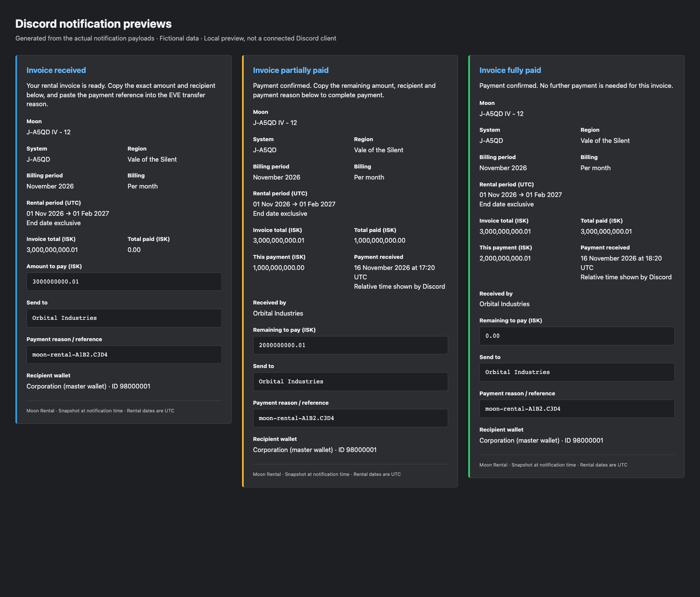
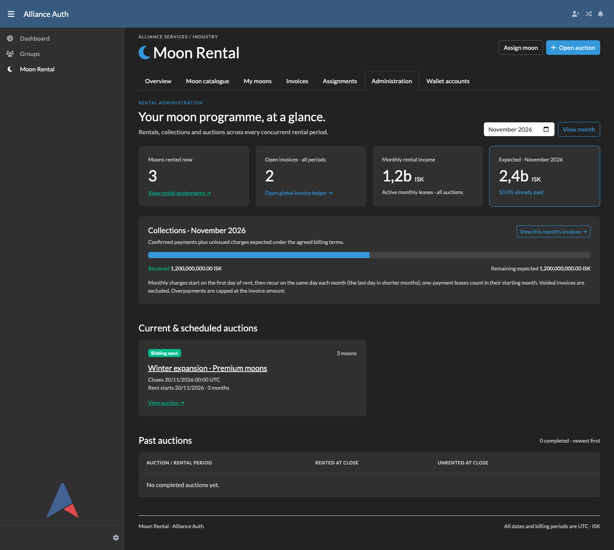
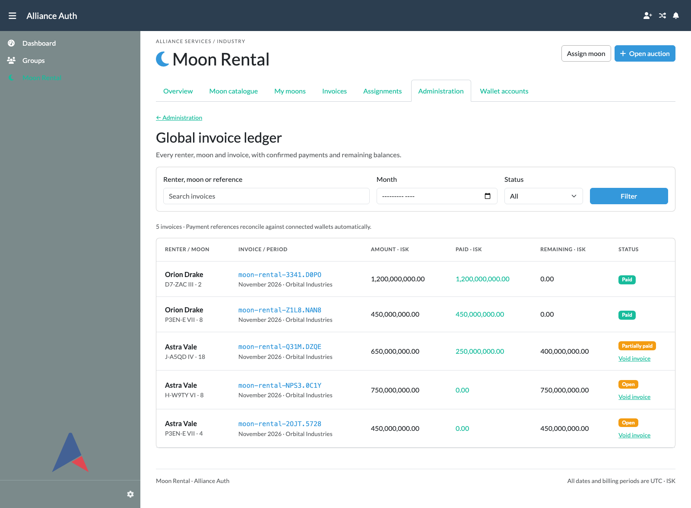
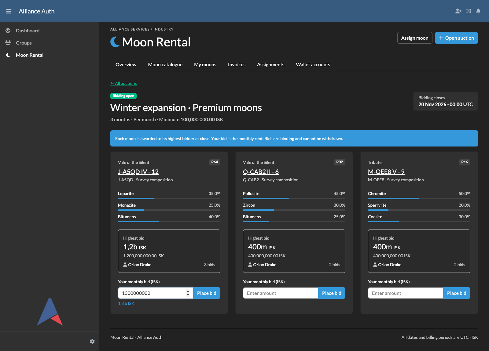
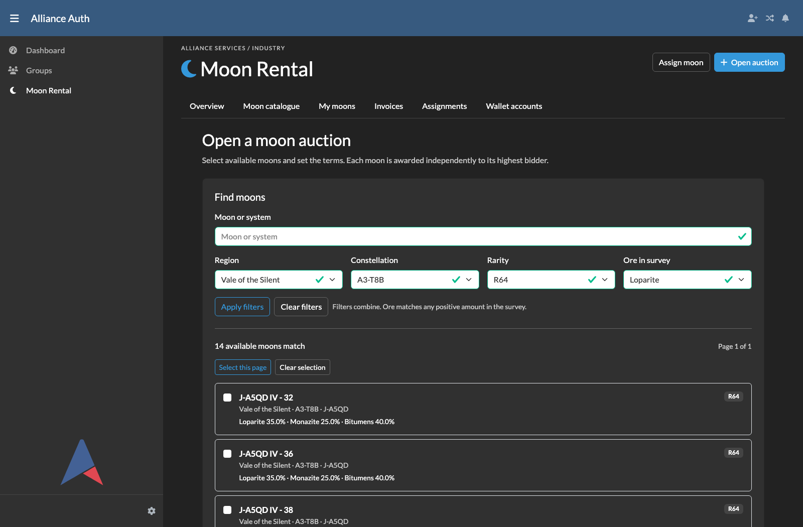
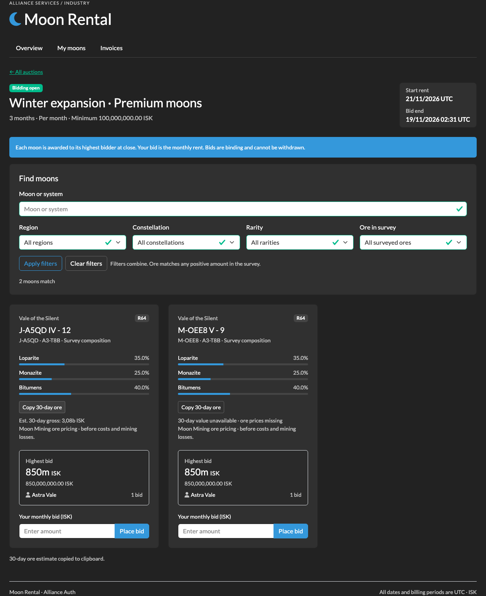
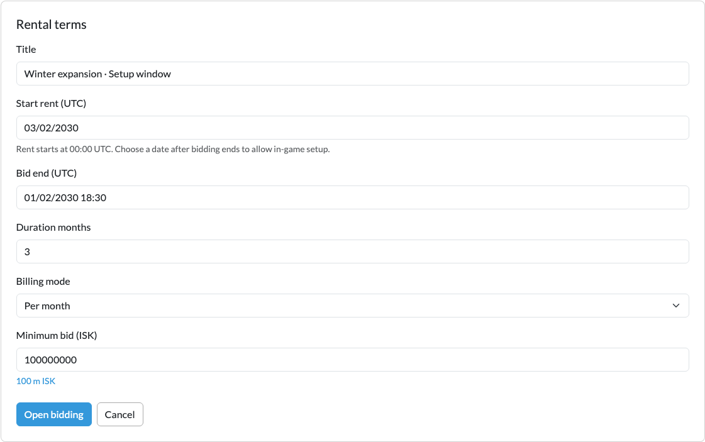

# Moon Rental for Alliance Auth

An Alliance Auth module for auctioning surveyed moons, managing leases and matching rent payments against EVE wallet journals.

**Requirements:** Python 3.10+, Alliance Auth 5.6.x, Django 5.2, aa-moonmining 3.2.x, and your normal Alliance Auth Celery/Redis/database services. Use MySQL/MariaDB in production; SQLite is only a local demo/test database and does not provide the row locks required for competing bids.

## Features

- Admin-only synchronization of moon names, systems, regions, constellations, rarity, ore distribution and value estimates from `moonmining`. Source data is never modified. Removed moons cannot be offered again; existing leases remain accessible.
- Optional integration with [aa-structures](https://pypi.org/project/aa-structures/) shows each moon's structure type and name, for example `Metenox Moon Drill "My metenox name"`, in the catalogue, moon details, assignment/auction selectors, rental assignments and My moons. Multiple structures are listed separately. Details come directly from locally synced Structures data and follow its visibility permissions.
- The moon catalogue, individual catalogue details and **Export CSV** are restricted to rental managers and admins. CSV downloads include all moons matching the current search across every page, with moon IDs, names, systems, regions, constellations, rarity, survey composition, exact estimated monthly ISK values, status and UTC sync times. Files use UTF-8 with a BOM for spreadsheet compatibility; formula-like text is escaped.
- Managers create auctions for multiple available moons, choose an optional scheduled UTC bidding start, a rent start date (`dd/mm/yyyy`) and a UTC bidding deadline (`dd/mm/yyyy hh:mm`), term of 1–120 months, default and individual public starting prices, and monthly (default) or single-payment billing. The rent starts at 00:00 UTC on a date after bidding closes, leaving time for in-game setup.
- Members see each moon's survey, highest bidder and bid amount. **Copy 30-day ore** copies estimated uncompressed ore units as tab-separated item/quantity rows for appraisal tools and spreadsheets without displaying the ore list. An estimated 30-day gross ISK value appears when all required ore prices are available. New bids must strictly exceed the current highest bid. Bids are binding; there is no withdrawal or early settlement endpoint.
- Auction bid arrows, keyboard arrows and the mouse wheel adjust the amount by exactly **100 million ISK**, preserving cents and clamping at the moon’s starting price. Exact manually entered bids remain supported and are validated on the server.
- Every ISK input shows a live compact preview, such as `1,2 b ISK`, while submitting the original exact amount. Previews use `k`, `m`, `b` and `t` for thousands, millions, billions and trillions.
- Highest and winning bids use the same compact units (for example, `1,2b ISK`), with the full exact amount shown underneath.
- Each moon is independently awarded at the deadline. Settlement is automatic and repeatable. An admin can end/correct an assignment; managers cannot alter existing leases, including auction awards.
- Managers can directly assign available moons at a fixed rent. Members see current and past leases under **My moons**.
- Auction creation and direct assignment offer paginated moon selectors with combined region, constellation, rarity and survey-ore filters, plus moon/system search. Selections and rental terms survive filtering and page changes. Auction selection supports selecting a page, removing individual selections and clearing selections. The bidding page has the same filters and pagination.
- An admin **Administration** overview combines all concurrent rental periods: moons currently rented, all open invoices, current monthly recurring rental income, and a selectable month’s expected revenue, confirmed collections and percentage paid. Current/scheduled auctions and paginated past auctions link to rented/unrented outcomes. A searchable, paginated **global invoice ledger** shows renter, moon, reference, amount, paid amount, remaining balance and status.
- Auction creation includes a searchable, paginated previous-auction picker, newest first. Add available moons and their individual starting prices while retaining current selections and terms; rented, reserved and unavailable moons are skipped.
- Optional Discord webhook reminders at selected 24h/12h/6h/1h thresholds; optional Discord Multiverse DMs for outbids, newly issued invoices and partial/full payments. Delivery failures are retried independently of financial transactions.
- Calendar-month invoices, copyable payment references such as `moon-rental-A1B2.C3D4`, exact ISK amounts and recipient names. Managers see open, paid and void invoices for all renters; members see only their own.
- Multiple SSO-authorized character or corporation wallets, with exactly one default once connected. Corporations read **master wallet / division 1 only**.
- Incoming donations are matched by invoice reference. Partial payments work; duplicate journal entries cannot pay twice. Only matched payment receipts are stored, never the raw wallet journal.
- Uses `allianceauth/base-bs5.html`, Bootstrap 5 components and theme variables. Darkly, Flatly and other installed AA themes follow the user's existing theme preference.
- Audited administrative actions and configurable retention, default 12 months.

## Installation

Install into your existing Alliance Auth virtual environment (there is no separate web service):

```bash
pip install 'git+https://github.com/Redone0001/aa-moon-rental.git@master'
```

In your Alliance Auth `local.py`, after the existing app and scheduler configuration:

```python
from celery.schedules import crontab

# moonmining and eveuniverse must already be installed and configured.
INSTALLED_APPS += ["moon_rental"]

MOON_RENTAL_RETENTION_MONTHS = 12

CELERYBEAT_SCHEDULE["moon-rental-lifecycle"] = {
    "task": "moon_rental.tasks.run_regular_updates",
    "schedule": crontab(minute="*"),
}
CELERYBEAT_SCHEDULE["moon-rental-wallets"] = {
    "task": "moon_rental.tasks.scan_wallets",
    "schedule": crontab(minute="*/15"),
}
CELERYBEAT_SCHEDULE["moon-rental-retention"] = {
    "task": "moon_rental.tasks.cleanup_history",
    "schedule": crontab(minute=30, hour=3),
}
```

Run `python manage.py migrate` and `python manage.py collectstatic --noinput`, then restart Auth's web, Celery worker and beat services. The app registers its own menu and URLs at `/moon-rental/`.

Upgrades also require migration and static collection. Migration `0007` adds rich Discord embed snapshots; pending plain-text notifications remain deliverable. Migration `0006` adds scheduled bidding, starting-price snapshots and the notification queue. Existing auctions stay open according to their existing deadlines; each existing lot inherits its auction’s original minimum bid. Migration `0005` preserves existing auctions' original deadline-based rent starts. After upgrading, an admin must run **Sync Moon Mining** to populate the new 30-day estimates; the copy button stays disabled until sufficient source data is available. Migration `0004` indexes ores from existing survey snapshots and backfills constellations from locally stored Eve Universe moons without ESI calls. If a constellation is missing locally, the next admin **Sync Moon Mining** fills it from the source survey.

For structure details, install and configure [aa-structures](https://aa-structures.readthedocs.io/) in the same Auth instance, including `"structures"` in `INSTALLED_APPS`. The optional dependency extra `.[structures]` installs aa-structures 4.x (4.1+), verified with Alliance Auth 5.6, Django 5.2, django-esi 10.1 and Eve Universe 2.2. Give viewers `structures.basic_access` plus the appropriate `structures.view_corporation_structures`, `structures.view_alliance_structures` or `structures.view_all_structures` permission. Rental permissions alone do not grant structure visibility.

Structures must have a locally stored `eve_moon` link matching the surveyed moon's EVE ID; names and proximity are never guessed. Rename, removal and visibility changes appear on the next page load after Structures updates its local data. No Moon Rental migration or survey resync is needed for this integration. **No visible structure** means no linked structure is visible to that viewer, rather than proof that the moon is empty. Without Structures installed or basic access, the display reads **Unavailable**. CSV export continues to contain survey and rental data.

Add these scopes to the **existing Alliance Auth EVE developer application**, then use **Wallet accounts → Connect character / Connect corporation** as a rental admin:

```text
esi-wallet.read_character_wallet.v1
esi-wallet.read_corporation_wallets.v1
```

The selected character must belong to the admin's Auth account. Corporate authorization must have an appropriate EVE wallet role; access is verified against ESI before saving. Tokens stay in Alliance Auth's `django-esi` token store. Reconnect when scopes, roles, character ownership or token authorization change. Wallet health and last successful scan are shown in the app.

## Permissions and first use

Assign permissions to AA groups/states in Django admin:

| Permission | Capabilities |
| --- | --- |
| `moon_rental.basic_access` | View auction surveys, bid, see personal rentals and invoices |
| `moon_rental.manage_rentals` | Member capabilities plus moon catalogue, moon details, CSV export, auctions, direct assignments and all invoices |
| `moon_rental.administer_rentals` | Manager capabilities plus sync, wallets, assignment corrections and invoice voiding |

Managers and admins inherit app capabilities; they do not need all three permissions. Merely being Django `is_staff` does not grant rental administration. Superusers have all capabilities. Assignments, money records and audit trails remain read-only in Django admin. The singleton **Moon Rental → Configuration** screen permits rental admins with Django staff access to edit only Discord delivery settings; wallet selection still goes through Wallet accounts.

1. A rental admin connects a payment wallet (the first becomes the default) and syncs Moon Mining.
2. A manager opens an auction or assigns a free moon. Use **Find moons** to combine region, constellation, rarity and ore filters; ore matches any positive surveyed percentage, and rarity is the moon's overall survey class. Choose moons across pages before submitting the rental terms. A reserved or rented moon cannot be selected again.
3. Members can inspect scheduled auctions immediately; bids are accepted only from the configured opening time until the deadline. No opening worker is required to enable bidding. The lifecycle task assigns winners on or after the deadline. Winning moons remain reserved as scheduled rentals until the advertised rent start. No-bid moons become available again.
4. Renters pay the invoice recipient in EVE, copying the reference into the ISK transfer reason. Wallet scans confirm payment.

## Billing and reconciliation rules

- All business dates are **UTC**. A term ends on an exclusive end date calculated using calendar months (31 January + one month = 28/29 February).
- Monthly invoices are due on each first of the month during the lease. Mid-month awards have their first invoice on the following first, with no proration or initial partial-month charge. An award on the first is invoiced immediately. A monthly term ending mid-month still incurs that month's full invoice if active on the first.
- One-time bids/prices cover the full term and are invoiced on the rent start date (or immediately for direct assignments). Auctions can be awarded before rent starts; no invoices are issued during the setup window.
- Delayed workers backfill missed invoice periods and use the advertised rent start as the lease start. Existing auctions migrated from before the separate start date retain their original deadline date. Repeated runs cannot duplicate awards or invoices. A billing cursor prevents paid invoices removed by retention from being recreated.
- Invoice recipients are snapshots of the default at issuance. Changing the default affects future invoices. A matching payment to any enabled configured wallet is accepted.
- Only positive incoming `player_donation` entries with the configured account as recipient are eligible. The reason must contain exactly one complete invoice reference (case insensitive). Entries before invoice creation, outgoing transfers, malformed amounts/dates, unrelated reasons and multiple references are ignored. Third parties may pay a renter's invoice.
- Multiple payments can settle an invoice. Overpayment settles that invoice and is recorded in its receipt; it is not automatically credited to a future invoice or refunded. No wallet history is stored for unmatched transfers.
- References must be included correctly in the transfer reason. Incorrect-reference payments need an in-game correction; there is deliberately no unaudited “mark paid” endpoint. Admins can void an open invoice with an explanation. Voiding does not refund payments.
- Ending/correcting a lease stops future billing. Existing invoices keep their original renter, amount and recipient; use the separate admin-only void action if appropriate. Reassignment creates a new lease and audit trail.
- ESI journals have a limited upstream history. Keep scans running and resolve failed scans promptly; transfers that disappear from ESI before a successful scan cannot be recovered by this module. Requests have timeouts, all journal pages are scanned, and one wallet failure does not stop scans of other accounts.

## Administration and monthly revenue

Open **Administration** with `moon_rental.administer_rentals`. The rented count includes leases active today; future reserved leases appear with their auctions and assignments. Monthly rental income sums active monthly leases across all auctions and direct assignments, excluding one-payment terms.

The selected month’s expected revenue uses non-void invoice snapshots plus charges not yet issued under the agreed billing rules. Monthly leases count only when active on that month’s first day; one-payment leases count in their starting month. Issued invoices retain their original amounts even after a lease ends. Voided invoices and charges already covered by the billing cursor are not forecast again. The paid percentage includes partial payments, caps overpayments at each invoice’s amount, and divides by the month’s expected revenue. It measures collections against that month’s invoices rather than the calendar date of a transfer.

Click **Open global invoice ledger** for all unpaid invoices, or **View this month’s invoices** for the selected billing month. Filter by renter, moon, reference or status. Unissued forecast charges appear in expected revenue and enter the ledger when the lifecycle task issues them. Past-auction counts describe awards at close; click either count for its moon list, even if a lease has since expired.

## Discord notifications and payment wallet setup

The existing lifecycle schedule (`run_regular_updates`, every minute) now also queues reminders and delivers pending notifications. Keep the wallet scan schedule enabled for payment confirmations.

1. As a rental admin with Django staff access, open **Django admin → Moon Rental → Configuration**. Set **Discord webhook URL** to an incoming webhook for the public auction channel. Leave it blank to disable public reminders. Only HTTPS `discord.com` webhook URLs are accepted; redirects are not followed. The webhook is independent of Discord Multiverse.
2. Select the desired 24h, 12h, 6h and 1h reminders while creating each auction. Clear all choices for no reminders. Thresholds before bidding opens are skipped. A delayed worker sends only the latest crossed threshold and retires stale pending reminders. Closed auctions never send pending reminders. Messages suppress automatic mentions.
3. For private messages, install and configure [allianceauth-discord-multiverse](https://pypi.org/project/allianceauth-discord-multiverse/) in the Auth instance (`aadiscordmultiverse` in `INSTALLED_APPS`). Enter its managed Discord server’s ID in **Discord guild ID** and enable **Discord DM enabled**. Renters must have a linked Multiverse account on that server. Delivery uses Multiverse’s `MultiDiscordUser.uid` and its configured `DISCORD_BOT_TOKEN`; no second bot token is stored by Moon Rental. If the module, server ID, bot token or linked account is absent, private delivery is skipped. The rest of Moon Rental continues to work.
4. Under **Wallet accounts**, connect your alliance's preferred character or corporation payment wallet and select it as default. Use an authorized character for corporation wallets; scans read master wallet/division 1. Each new invoice snapshots that recipient and generates its own unique reference. The renter copies that reference into the EVE payment reason; scans recognize partial and full incoming donations and queue a DM after each newly matched receipt. No live wallet connection is created by the demo or screenshot script.

New notifications use Discord embeds with a clickable title linking to the relevant auction or invoice. Invoice and payment embeds include the moon, system, region, billing period and mode, lease dates, invoice total, total paid, recipient name/type/ID, and remaining balance. Payment confirmations also show the latest payment, its date and the receiving account. Separate code blocks provide the exact amount **without grouping separators or an ISK suffix**, the recipient name and the payment reference for copying into EVE. Copy/select behavior depends on the Discord client; no bot interaction or custom clipboard button is required. A partial-payment message repeats all transfer instructions, while a fully paid message clearly states no further payment is needed.

Outbid embeds show the previous bid, the new highest bid, starting price, moon location, billing terms, closing time and lease dates. Public reminder embeds show the auction, moon count, billing terms and lease dates. Discord renders closing/payment timestamps in each viewer's timezone, including relative time; lease dates remain UTC. Invoice title links filter to that exact invoice and preserve the existing renter/manager access checks. Each message snapshots its event-time values, so older payment messages keep their original balances rather than silently changing after later receipts.

Outbid DMs go to the previous highest bidder when a different member takes the lead. Raising your own bid does not send a DM. Invoice DMs are generated when a charge is actually issued, including the reference, exact amount and recipient. All events enter a transactional delivery queue so rollbacks cannot send false notices and duplicate wallet entries cannot create duplicate payment notices. Delivery uses timeouts, rate-limit backoff and retries without logging credentials or raw response bodies. Delivery cannot be guaranteed exactly once after a network interruption; stable DM nonces reduce immediate duplicates. Discord privacy settings may prevent DMs.

## Fixed 30-day ore estimates

Estimates use Moon Mining's configured `MOONMINING_VOLUME_PER_DAY` rather than hardcoding a universal in-game extraction rate. For each positive surveyed ore share:

```text
ore units = floor(daily volume × 30 × survey fraction / ore unit volume)
gross ISK = sum(whole ore units × Moon Mining current price per unit)
```

The sync snapshots these quantities, the daily volume, pricing mode, reprocessing yield and gross value together. Each ore uses its locally stored Eve Universe unit volume. Quantities remain uncompressed and survey fractions are never normalized: a 35% survey still represents 35% of the configured full pull. Zero-share ores are excluded. Missing unit volume disables the entire export; missing or zero prices leave the ISK estimate unavailable while keeping the quantities copyable. Values and quantities refresh on the next admin sync.

This calculation uses exactly 30 days; Moon Mining's existing monthly value usually uses `MOONMINING_DAYS_PER_MONTH` (default 30.4). Its documented daily-volume default is 960,400 m³, which yields 28,812,000 m³ over 30 days before survey shares. Configure Moon Mining's daily volume to match your operation. Pricing follows Moon Mining's ore or reprocessed-material pricing, including the configured reprocessing yield. It uses average market prices, not a live Jita quote. The gross estimate excludes rent, fuel, fees, hauling, mining losses and any unmodeled extraction bonuses. See [Moon Mining's settings and pricing documentation](https://apps.allianceauth.org/apps/detail/aa-moonmining).

## Data retention

`MOON_RENTAL_RETENTION_MONTHS` must be a positive integer. The daily cleanup removes paid/void invoices closed before the cutoff (with their matched receipts), expired/ended leases with no invoices, completed auctions with no retained leases, and old audit events. Active leases, unsettled auctions and **unpaid invoices and their partial-payment receipts are preserved** until resolved. Thus retention is a history-cleanup policy, not automatic debt forgiveness. Backups and Alliance Auth's token/user retention are managed separately.

## Development and verification

```bash
python3 -m venv .venv
. .venv/bin/activate
pip install -e '.[test,screenshots]'
python manage.py migrate
python manage.py check
pytest --cov=moon_rental --cov-report=term-missing
ruff check .
ruff format --check .
python -m build
```

Alliance Auth depends on `mysqlclient`; install your OS's MySQL/MariaDB client development headers and `pkg-config` first. Local settings in `tests/settings.py` use SQLite, an in-memory cache and mocked core Redis statistics; production never imports these settings. Tests use the real AA templates, permissions, database migrations and moonmining models. SSO/ESI calls are tested with controlled responses rather than live player credentials.

CI checks Python 3.10/3.12/3.13, packaging, migrations, code style, and the full suite on MySQL 8.4, including simultaneous bid/settlement tests. For an existing local MySQL database `moon_rental` (root password `test` on localhost), set `MOON_RENTAL_TEST_MYSQL=1` to run those tests locally.

For a disposable demo and screenshot reproduction:

```bash
python manage.py migrate
python scripts/seed_demo.py
python manage.py collectstatic --noinput
playwright install chromium
python manage.py runserver 127.0.0.1:8000 --noreload
# In another terminal with the same venv:
python scripts/screenshots.py
python scripts/screenshot_filters.py
python scripts/screenshot_estimates.py
python scripts/screenshot_administration.py
python scripts/screenshot_discord_embeds.py
```

Demo data uses fictional renters and survey values. Demo users have unusable passwords. The screenshot script creates a local Django session, exercises bidding and clipboard copying, and captures the real pages at desktop/mobile sizes and under Darkly/Flatly. **Never use test settings or seed scripts against a production database.**

## Screenshots

Discord embed previews, rendered locally from the actual payload builders using fictional data (these are not screenshots from a connected Discord client):



[Light payment previews](docs/screenshots/discord-payments-light.png) · [Auction notification previews](docs/screenshots/discord-auctions-light.png)

New administration and auction controls (fictional demo data):




[Scheduled auction creation](docs/screenshots/auction-schedule-create-darkly.png) · [100m bid controls](docs/screenshots/auction-bid-controls-flatly.png) · [Mobile administration](docs/screenshots/admin-overview-mobile.png) · [Discord settings](docs/screenshots/discord-configuration-darkly.png)


Screenshots are of the running module inside Alliance Auth, using fictional data.









See [all screenshots](docs/screenshots/) for overview, catalogue, My moons, wallet settings, filtered auction/assignment selectors, Flatly and mobile views.

Structure display examples: [catalogue (Darkly)](docs/screenshots/structures-catalogue-darkly.png), [catalogue (Flatly)](docs/screenshots/structures-catalogue-flatly.png), [assignments (Darkly)](docs/screenshots/structures-assignments-darkly.png) and [assignment selection (Flatly)](docs/screenshots/structures-selection-flatly.png).

## Collaboration and security

`master` is the initial and protected default branch. Work on feature branches and submit pull requests. The repository requires a review, passing required checks and resolved conversations, applies protection to admins, and blocks force pushes and branch deletion. See [CONTRIBUTING.md](CONTRIBUTING.md) and [SECURITY.md](SECURITY.md).

Licensed under MIT. EVE Online is a trademark of CCP hf. This is an independent community application.
