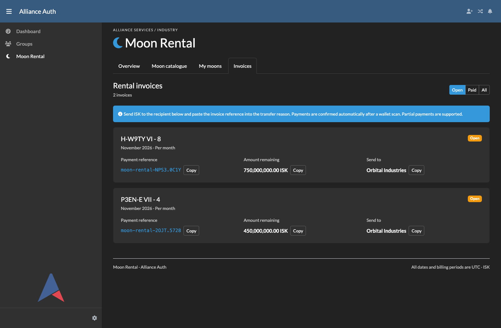

# Moon Rental for Alliance Auth

An Alliance Auth module for auctioning surveyed moons, managing leases and matching rent payments against EVE wallet journals.

**Requirements:** Python 3.10+, Alliance Auth 5.6.x, Django 5.2, aa-moonmining 3.2.x, and your normal Alliance Auth Celery/Redis/database services. Use MySQL/MariaDB in production; SQLite is only a local demo/test database and does not provide the row locks required for competing bids.

## Features

- Admin-only synchronization of moon names, systems, regions, rarity, ore distribution and value estimates from `moonmining`. Source data is never modified. Removed moons cannot be offered again; existing leases remain accessible.
- Managers open auctions for multiple available moons, choose a UTC deadline, term of 1–120 months, minimum bid and monthly (default) or single-payment billing.
- Members see each moon's survey, highest bidder and bid amount. New bids must strictly exceed the current highest bid. Bids are binding; there is no withdrawal or early settlement endpoint.
- Each moon is independently awarded at the deadline. Settlement is automatic and repeatable. An admin can end/correct an assignment; managers cannot alter existing leases, including auction awards.
- Managers can directly assign available moons at a fixed rent. Members see current and past leases under **My moons**.
- Calendar-month invoices, copyable payment references such as `moon-rental-A1B2.C3D4`, exact ISK amounts and recipient names. Managers see open, paid and void invoices for all renters; members see only their own.
- Multiple SSO-authorized character or corporation wallets, with exactly one default once connected. Corporations read **master wallet / division 1 only**.
- Incoming donations are matched by invoice reference. Partial payments work; duplicate journal entries cannot pay twice. Only matched payment receipts are stored, never the raw wallet journal.
- Uses `allianceauth/base-bs5.html`, Bootstrap 5 components and theme variables. Darkly, Flatly and other installed AA themes follow the user's existing theme preference.
- Audited administrative actions and configurable retention, default 12 months.

## Installation

Install into your existing Alliance Auth virtual environment (there is no separate web service):

```bash
pip install 'git+https://github.com/Redone0001/aa-moon-rental.git@master'
```

In your Alliance Auth `local.py`, after the existing app and scheduler configuration:

```python
from celery.schedules import crontab

# moonmining and eveuniverse must already be installed and configured.
INSTALLED_APPS += ["moon_rental"]

MOON_RENTAL_RETENTION_MONTHS = 12

CELERYBEAT_SCHEDULE["moon-rental-lifecycle"] = {
    "task": "moon_rental.tasks.run_regular_updates",
    "schedule": crontab(minute="*"),
}
CELERYBEAT_SCHEDULE["moon-rental-wallets"] = {
    "task": "moon_rental.tasks.scan_wallets",
    "schedule": crontab(minute="*/15"),
}
CELERYBEAT_SCHEDULE["moon-rental-retention"] = {
    "task": "moon_rental.tasks.cleanup_history",
    "schedule": crontab(minute=30, hour=3),
}
```

Run `python manage.py migrate` and `python manage.py collectstatic --noinput`, then restart Auth's web, Celery worker and beat services. The app registers its own menu and URLs at `/moon-rental/`.

Add these scopes to the **existing Alliance Auth EVE developer application**, then use **Wallet accounts → Connect character / Connect corporation** as a rental admin:

```text
esi-wallet.read_character_wallet.v1
esi-wallet.read_corporation_wallets.v1
```

The selected character must belong to the admin's Auth account. Corporate authorization must have an appropriate EVE wallet role; access is verified against ESI before saving. Tokens stay in Alliance Auth's `django-esi` token store. Reconnect when scopes, roles, character ownership or token authorization change. Wallet health and last successful scan are shown in the app.

## Permissions and first use

Assign permissions to AA groups/states in Django admin:

| Permission | Capabilities |
| --- | --- |
| `moon_rental.basic_access` | Browse moons, bid, see personal rentals and invoices |
| `moon_rental.manage_rentals` | Member capabilities plus auctions, direct assignments and all invoices |
| `moon_rental.administer_rentals` | Manager capabilities plus sync, wallets, assignment corrections and invoice voiding |

Managers and admins inherit app capabilities; they do not need all three permissions. Merely being Django `is_staff` does not grant rental administration. Superusers have all capabilities. The app's Django admin model screens are read-only so assignments, money records and audit trails cannot be bypassed with ordinary model editing.

1. A rental admin connects a payment wallet (the first becomes the default) and syncs Moon Mining.
2. A manager opens an auction or assigns a free moon. A reserved or rented moon cannot be selected again.
3. Members bid; the lifecycle task assigns winners on or after the deadline. No-bid moons become available again.
4. Renters pay the invoice recipient in EVE, copying the reference into the ISK transfer reason. Wallet scans confirm payment.

## Billing and reconciliation rules

- All business dates are **UTC**. A term ends on an exclusive end date calculated using calendar months (31 January + one month = 28/29 February).
- Monthly invoices are due on each first of the month during the lease. Mid-month awards have their first invoice on the following first, with no proration or initial partial-month charge. An award on the first is invoiced immediately. A monthly term ending mid-month still incurs that month's full invoice if active on the first.
- One-time bids/prices cover the full term and are invoiced immediately at award/assignment.
- Delayed workers backfill missed invoice periods and use the original auction deadline as the lease start. Repeated runs cannot duplicate awards or invoices. A billing cursor prevents paid invoices removed by retention from being recreated.
- Invoice recipients are snapshots of the default at issuance. Changing the default affects future invoices. A matching payment to any enabled configured wallet is accepted.
- Only positive incoming `player_donation` entries with the configured account as recipient are eligible. The reason must contain exactly one complete invoice reference (case insensitive). Entries before invoice creation, outgoing transfers, malformed amounts/dates, unrelated reasons and multiple references are ignored. Third parties may pay a renter's invoice.
- Multiple payments can settle an invoice. Overpayment settles that invoice and is recorded in its receipt; it is not automatically credited to a future invoice or refunded. No wallet history is stored for unmatched transfers.
- References must be included correctly in the transfer reason. Incorrect-reference payments need an in-game correction; there is deliberately no unaudited “mark paid” endpoint. Admins can void an open invoice with an explanation. Voiding does not refund payments.
- Ending/correcting a lease stops future billing. Existing invoices keep their original renter, amount and recipient; use the separate admin-only void action if appropriate. Reassignment creates a new lease and audit trail.
- ESI journals have a limited upstream history. Keep scans running and resolve failed scans promptly; transfers that disappear from ESI before a successful scan cannot be recovered by this module. Requests have timeouts, all journal pages are scanned, and one wallet failure does not stop scans of other accounts.

## Data retention

`MOON_RENTAL_RETENTION_MONTHS` must be a positive integer. The daily cleanup removes paid/void invoices closed before the cutoff (with their matched receipts), expired/ended leases with no invoices, completed auctions with no retained leases, and old audit events. Active leases, unsettled auctions and **unpaid invoices and their partial-payment receipts are preserved** until resolved. Thus retention is a history-cleanup policy, not automatic debt forgiveness. Backups and Alliance Auth's token/user retention are managed separately.

## Development and verification

```bash
python3 -m venv .venv
. .venv/bin/activate
pip install -e '.[test,screenshots]'
python manage.py migrate
python manage.py check
pytest --cov=moon_rental --cov-report=term-missing
ruff check .
ruff format --check .
python -m build
```

Alliance Auth depends on `mysqlclient`; install your OS's MySQL/MariaDB client development headers and `pkg-config` first. Local settings in `tests/settings.py` use SQLite, an in-memory cache and mocked core Redis statistics; production never imports these settings. Tests use the real AA templates, permissions, database migrations and moonmining models. SSO/ESI calls are tested with controlled responses rather than live player credentials.

CI checks Python 3.10/3.12/3.13, packaging, migrations, code style, and the full suite on MySQL 8.4, including simultaneous bid/settlement tests. For an existing local MySQL database `moon_rental` (root password `test` on localhost), set `MOON_RENTAL_TEST_MYSQL=1` to run those tests locally.

For a disposable demo and screenshot reproduction:

```bash
python manage.py migrate
python scripts/seed_demo.py
python manage.py collectstatic --noinput
playwright install chromium
python manage.py runserver 127.0.0.1:8000 --noreload
# In another terminal with the same venv:
python scripts/screenshots.py
```

Demo data uses fictional renters and survey values. Demo users have unusable passwords. The screenshot script creates a local Django session, exercises bidding and clipboard copying, and captures the real pages at desktop/mobile sizes and under Darkly/Flatly. **Never use test settings or seed scripts against a production database.**

## Screenshots

Screenshots are of the running module inside Alliance Auth, using fictional data.




See [all screenshots](docs/screenshots/) for overview, catalogue, My moons, wallet settings, Flatly and mobile views.

## Collaboration and security

`master` is the initial and protected default branch. Work on feature branches and submit pull requests. The repository requires a review, passing required checks and resolved conversations, applies protection to admins, and blocks force pushes and branch deletion. See [CONTRIBUTING.md](CONTRIBUTING.md) and [SECURITY.md](SECURITY.md).

Licensed under MIT. EVE Online is a trademark of CCP hf. This is an independent community application.
